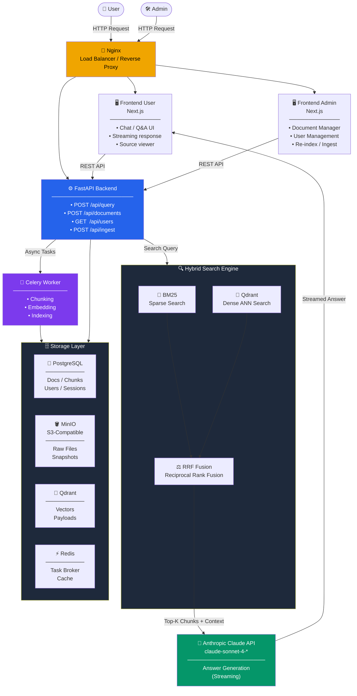
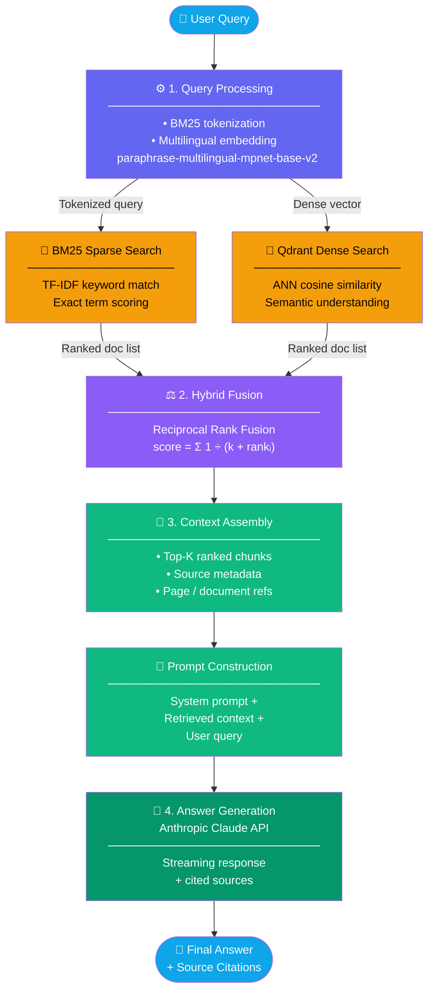

# Hệ Thống Tìm Kiếm Tài Liệu Học Thuật RAG

Hệ thống Retrieval-Augmented Generation (RAG) dùng để tìm kiếm và trả lời câu hỏi về tài liệu học thuật. Xây dựng bằng FastAPI, Next.js, PostgreSQL, Qdrant, MinIO, Redis và Claude.

**Trạng thái:** Hoàn thành Phase 4 — truy xuất lai hoàn chỉnh (dense + sparse + rerank), xử lý câu hỏi tổng hợp, đa ngôn ngữ (Anh + Việt), xóa tài liệu cascade đầy đủ, điều phối bằng Docker.

---

## Mục Lục

- [Bắt Đầu Nhanh](#bắt-đầu-nhanh)
- [Kiến Trúc](#kiến-trúc)
- [Cấu Trúc Repo](#cấu-trúc-repo)
- [Dịch Vụ & Cổng](#dịch-vụ--cổng)
- [Sử Dụng](#sử-dụng)
- [Tính Năng Chính](#tính-năng-chính)
- [Tech Stack](#tech-stack)
- [Biến Môi Trường](#biến-môi-trường)
- [Phát Triển](#phát-triển)
- [Triển Khai](#triển-khai)
- [Khắc Phục Sự Cố](#khắc-phục-sự-cố)
- [Đội Ngũ](#đội-ngũ)

---

## Bắt Đầu Nhanh

### Yêu Cầu
- Docker Desktop (đã cài và đang chạy)
- 4 GB RAM cấp cho Docker (khuyến nghị 8 GB nếu ingest nặng)
- API key TrollLLM/Claude của bạn

### 1. Clone & Chuẩn bị

```bash
git clone <repo-url>
cd rag-system
cp .env.example .env
```

### 2. Thêm API key vào `.env`

```bash
ANTHROPIC_API_KEY=sk-trollllm-your-key-here
```

### 3. Khởi động toàn bộ hệ thống

```bash
docker compose up -d --build
```

Lần đầu chạy mất 5–10 phút (build Next.js apps, pull images, init DB, tải embedding + reranker model).

### 4. Kiểm tra các dịch vụ đang chạy

```bash
docker compose ps
```

Tất cả 8 container phải hiện `running` hoặc `healthy`.

### 5. Mở giao diện

- **Chat người dùng:** http://localhost:3000 
- **Trang admin:** http://localhost:3001
- **API docs:** http://localhost:8000/docs
- **MinIO console:** http://localhost:9001 (đăng nhập: `minioadmin` / `minioadmin`)
- **Qdrant dashboard:** http://localhost:6333/dashboard

---

## Kiến Trúc

## 🏗️ System Architecture



---

## 🔄 RAG Pipeline Flow



---


## Cấu Trúc Repo

```
rag-system/
├── .git/
├── .gitignore                     # Bỏ qua .env, node_modules, __pycache__, v.v.
├── .env                           # Cấu hình local (KHÔNG commit)
├── .env.example                   # Template cho .env (có commit)
│
├── docker-compose.yml             # Điều phối 8 dịch vụ
├── Dockerfile.backend             # Image Python 3.11 + FastAPI
├── Dockerfile.worker              # Image Python 3.11 + Celery
│
├── README.md                      # File này
├── LICENSE                        # MIT
├── requirements.txt               # Python deps (backend + worker)
│
├── backend/                       # FastAPI application
│   ├── __init__.py
│   ├── config.py                  # Pydantic settings đọc từ .env
│   ├── main.py                    # REST routes: /api/ask, /api/search, /api/documents/*
│   ├── rag_embedding.py           # sentence-transformers embedding local
│   ├── rag_chunking.py            # Chunking theo câu, có map page
│   ├── rag_extraction.py          # Trích text từ PDF/DOCX/TXT/MD
│   ├── bm25_search.py             # BM25 keyword search + cache signature
│   ├── hybrid_search.py           # Dense + sparse fusion + rerank + xử lý câu hỏi tổng hợp
│   ├── models/
│   │   └── __init__.py            # SQLAlchemy: bảng Document, Conversation
│   └── storage/
│       ├── __init__.py
│       ├── database.py            # Engine + session PostgreSQL
│       ├── qdrant_client.py       # Thao tác vector DB (có payload index)
│       └── minio_client.py        # Object storage tương thích S3
│
├── worker/                        # Celery xử lý nền
│   ├── __init__.py
│   └── tasks/
│       ├── __init__.py
│       └── ingest.py              # extract → chunk → embed → upsert (idempotent)
│
├── frontend-user/                 # UI chat sinh viên (Next.js)
│   ├── Dockerfile
│   ├── package.json
│   ├── next.config.js
│   ├── tsconfig.json
│   ├── tailwind.config.js
│   └── src/app/
│       ├── globals.css
│       ├── layout.tsx
│       └── page.tsx               # Chat + upload panel + trích dẫn nguồn
│
├── frontend-admin/                # Quản lý tài liệu (Next.js)
│   ├── Dockerfile
│   ├── package.json
│   ├── next.config.js
│   ├── tsconfig.json
│   ├── tailwind.config.js
│   └── src/app/
│       ├── globals.css
│       ├── layout.tsx
│       └── page.tsx               # Upload, bảng tài liệu, polling trạng thái
│
└── nginx/                         # Reverse proxy
    ├── Dockerfile
    ├── nginx.conf
    └── conf.d/
        └── default.conf           # /api → backend, /admin → admin, / → user
```

### Các file quan trọng

| File | Mục đích |
|------|----------|
| `docker-compose.yml` | Định nghĩa 8 dịch vụ, volumes, networks, health checks |
| `backend/main.py` | REST endpoints: `/api/ask`, `/api/search`, `/api/documents/*` |
| `backend/hybrid_search.py` | Bộ não truy xuất: dense + sparse + RRF + rerank + xử lý câu hỏi tổng hợp |
| `backend/bm25_search.py` | Keyword search với cache invalidation theo signature |
| `backend/rag_chunking.py` | Chunking theo câu với map khoảng trang PDF |
| `worker/tasks/ingest.py` | Pipeline ingest nền (idempotent khi re-upload) |
| `backend/storage/qdrant_client.py` | Wrapper Qdrant có payload index trên `source` |
| `frontend-user/src/app/page.tsx` | UI chat sinh viên với trích dẫn `[file, pp. 5–6]` |
| `frontend-admin/src/app/page.tsx` | Admin: upload, list, delete, trạng thái |
| `nginx/conf.d/default.conf` | `/` → 3000, `/admin` → 3001, `/api/*` → 8000 |

---

## Dịch Vụ & Cổng

| Dịch vụ | Cổng | Mục đích |
|---------|------|----------|
| **Nginx** | 80 | Reverse proxy (entry point chính) |
| **Frontend User** | 3000 | UI chat |
| **Frontend Admin** | 3001 | Trang admin (upload, quản lý tài liệu) |
| **Backend API** | 8000 | FastAPI + logic RAG |
| **PostgreSQL** | 5432 | Metadata tài liệu, lịch sử Q&A |
| **Qdrant** | 6333 / 6334 | Vector database (HTTP / gRPC) |
| **MinIO** | 9000 / 9001 | Object storage / web console |
| **Redis** | 6379 | Hàng đợi Celery + cache |

Tất cả dịch vụ được định nghĩa trong `docker-compose.yml` với named volume persistent.

---

## Sử Dụng

### Admin: Upload Tài Liệu

1. Mở http://localhost:3001
2. Kéo thả hoặc click để upload file PDF / TXT / DOCX / MD (tối đa 100 MB)
3. Theo dõi trạng thái: **pending** → **processing** → **completed**
4. Khi xong, các chunks có thể tìm kiếm được trong Qdrant và BM25
5. Xem chi tiết file: size, số chunks, thời gian upload

**Xóa** sẽ remove tài liệu khỏi MinIO, Postgres, Qdrant, VÀ invalidate cache BM25 — cascade đầy đủ để tài liệu đã xóa không bao giờ bị trích dẫn lại.

### Người dùng: Đặt Câu Hỏi & Upload Tài Liệu

1. Mở http://localhost:3000 
2. Gõ câu hỏi (tiếng Anh hoặc tiếng Việt)
3. Click **Ask**
4. Claude trả lời với:
   - **Câu trả lời** — dựa trên tài liệu đã upload
   - **Nguồn** — tên file, khoảng trang (vd `pp. 5–6`), điểm liên quan, đoạn text mẫu
5. Lịch sử Q&A truy cập qua `GET /api/conversations`

**Upload trực tiếp từ trang user:**
1. Click nút **Upload** ở góc phải header
2. Kéo thả hoặc click vùng dashed để chọn file PDF / TXT / DOCX / MD (tối đa 100 MB)
3. Mỗi file hiển thị trạng thái real-time: `Uploading…` → `Indexing…` → `Ready`
4. Khi trạng thái là **Ready**, file đã được indexed và có thể hỏi ngay
5. Nếu lỗi (file quá lớn, MinIO down, v.v.), trạng thái chuyển sang **Failed** kèm thông báo

Lưu ý: Trang user dùng cùng endpoint `/api/documents/upload` với admin — tài liệu user upload chung không gian với admin (không có per-user scoping).

### API: Truy Cập Lập Trình

**Liệt kê tài liệu**
```bash
curl http://localhost:8000/api/documents
```

**Upload file**
```bash
curl -X POST http://localhost:8000/api/documents/upload -F "file=@myfile.pdf"
```

**Hỏi một câu**
```bash
curl -X POST http://localhost:8000/api/ask \
  -H "Content-Type: application/json" \
  -d '{"question": "Tóm tắt các chủ đề chính của tài liệu này", "top_k": 8}'
```

**Semantic search (không qua LLM)**
```bash
curl -X POST http://localhost:8000/api/search \
  -H "Content-Type: application/json" \
  -d '{"query": "ứng dụng machine learning", "top_k": 10}'
```

API docs đầy đủ: http://localhost/docs

---

## Tính Năng Chính

### Truy xuất lai (dense + sparse + rerank)
- **Dense:** Qdrant vector similarity với multilingual MiniLM embeddings
- **Sparse:** BM25 keyword search cho match từ chính xác (mã môn, tên riêng, v.v.)
- **Fusion:** Reciprocal Rank Fusion (RRF) gộp hai bảng xếp hạng
- **Rerank:** Cross-encoder đa ngôn ngữ (`mmarco-mMiniLMv2-L12-H384-v1`) đọc query + chunk cùng lúc để chấm điểm chính xác hơn

### Xử lý câu hỏi tổng hợp / khái quát
Tầng truy xuất tự phát hiện câu hỏi tổng hợp (`tóm tắt`, `chủ đề chính`, `so sánh`, `khái quát`, và các từ tiếng Anh tương đương) rồi điều chỉnh:
- Tăng `top_k` từ 8 → 12
- Lấy từ candidate pool lớn hơn (60 thay vì ~30)
- Đa dạng hóa theo tài liệu nguồn để một file không chiếm hết context
- Đổi sang system prompt định hướng tổng hợp khi gọi Claude

### Chunking theo câu với map trang PDF
- Chunk được cắt ở ranh giới câu (nhận biết dấu câu EN/VN/CJK) thay vì cắt giữa câu
- Với PDF, các trang được nối lại trước, rồi chia chunk, rồi map ngược về khoảng trang để trích dẫn hiện `pp. 5–6` chính xác
- Trang trống bị bỏ qua để nội dung không bị gán sai trang

### Hỗ trợ đa ngôn ngữ
- Embedding model: `sentence-transformers/paraphrase-multilingual-MiniLM-L12-v2`
- Reranker: bản đa ngôn ngữ khi embedding model đa ngôn ngữ
- Chunker nhận biết ranh giới câu tiếng Anh, tiếng Việt và CJK

### Xóa cascade đầy đủ
Xóa một tài liệu sẽ remove khỏi cả 4 store theo đúng thứ tự:
1. Qdrant (vectors) — đầu tiên, để khi retry không để lại embedding cũ
2. MinIO (file)
3. PostgreSQL (hàng metadata)
4. Cache BM25 in-memory — invalidate qua signature hash, query sau sẽ rebuild lại không còn nguồn đã xóa

### Re-ingest idempotent
Upload lại cùng tên file sẽ gọi `delete_by_source` trên Qdrant trước khi upsert, nên file rút gọn không để lại chunks mồ côi từ phiên bản cũ.

### Cache BM25 theo signature
BM25 index cache một MD5 signature của tất cả các cặp `(source, chunk_index)`. Nếu Qdrant thay đổi (upload, delete), signature đổi và cache tự rebuild — không cần invalidate thủ công.

### Ingest bất đồng bộ qua Celery
Upload trả về ngay (~100 ms). Worker xử lý extraction, chunking, embedding ở nền, nên PDF 50 trang không làm treo UI.

---

## Tech Stack

### Frontend
- **Framework:** Next.js 14 (React 18, TypeScript)
- **Styling:** Tailwind CSS
- **UI người dùng:** Input câu hỏi, hiển thị response, trích dẫn nguồn với khoảng trang, **upload panel có thể mở/đóng với drag-and-drop**, polling trạng thái indexing
- **UI admin:** Upload file, bảng tài liệu, polling trạng thái, delete với cascade đầy đủ

### Backend
- **Framework:** FastAPI (Python 3.11)
- **LLM:** Claude (`claude-sonnet-4-6` mặc định) qua proxy TrollLLM
- **RAG pipeline:**
  - Embeddings: `sentence-transformers` (local, không gọi API)
  - Dense search: Qdrant
  - Sparse search: BM25 (`rank-bm25`)
  - Rerank: cross-encoder (`sentence-transformers`)
  - Fusion: Reciprocal Rank Fusion (RRF)
- **Xử lý văn bản:**
  - PDF: pdfplumber
  - DOCX: python-docx
  - TXT/MD: file I/O chuẩn
  - Chunking: theo câu, có overlap

### Hạ tầng
- **PostgreSQL 15** — metadata tài liệu, lịch sử hội thoại
- **Qdrant** — lưu trữ vector (có payload index trên `source`)
- **MinIO** — object storage tương thích S3
- **Redis 7** — message queue cho Celery + cache
- **Celery** — xử lý tài liệu nền
- **Nginx** — reverse proxy và routing
- **Docker Compose** — điều phối 8 dịch vụ

---

## Biến Môi Trường

Copy `.env.example` sang `.env` rồi điền:

```bash
# Claude API (proxy TrollLLM)
ANTHROPIC_API_KEY=sk-trollllm-your-key-here
ANTHROPIC_BASE_URL=https://chat.trollllm.xyz
CLAUDE_MODEL=claude-sonnet-4-6
CLAUDE_MAX_TOKENS=4000          # Ngân sách lớn hơn để câu trả lời tổng hợp không bị cắt

# Database
POSTGRES_USER=raguser
POSTGRES_PASSWORD=ragpass
POSTGRES_DB=rag_db

# MinIO (mặc định, an toàn cho local dev)
MINIO_ACCESS_KEY=minioadmin
MINIO_SECRET_KEY=minioadmin

# Tuning RAG
CHUNK_SIZE=500
CHUNK_OVERLAP=100
RETRIEVAL_TOP_K=8               # Tự động mở rộng lên 12 cho câu hỏi tổng hợp
EMBEDDING_MODEL=sentence-transformers/paraphrase-multilingual-MiniLM-L12-v2

# Upload
MAX_UPLOAD_SIZE_MB=100

# Docker Hub (tùy chọn, dùng khi push image)
# DOCKER_USER=your-dockerhub-username
```

**Không bao giờ commit `.env`** — đã có trong `.gitignore`. Chỉ `.env.example` được track.

---

## Phát Triển

### Test local (không qua Docker)

```bash
# Terminal 1: Backend API
uvicorn backend.main:app --reload --port 8000

# Terminal 2: Worker
celery -A worker.tasks.celery_app worker --loglevel=info --pool=solo

# Terminal 3: Các dịch vụ storage (vẫn chạy trong Docker)
docker compose up postgres qdrant minio redis
```

### Xem logs

```bash
# Tất cả dịch vụ
docker compose logs -f

# Một dịch vụ cụ thể
docker compose logs -f backend
docker compose logs -f worker
docker compose logs -f frontend-user
```

### Rebuild sau khi sửa code

```bash
# Backend / worker
docker compose build backend worker
docker compose up -d

# Frontends
docker compose build frontend-user frontend-admin
docker compose up -d

# Toàn bộ
docker compose build
docker compose up -d
```

### Tinh chỉnh hiệu năng

- **Query đầu chậm?** BM25 build index lần đầu. Các query sau nhanh (cache theo signature).
- **Hết RAM khi ingest?** Tăng Docker memory lên 8 GB (Settings → Resources). Cross-encoder + embedder dùng ~2–3 GB. Tránh upload nhiều PDF lớn cùng lúc.
- **Worker bị kẹt?** `docker compose logs -f worker`. Đảm bảo Redis healthy.
- **Reranker chậm?** Set `use_rerank=False` trong `hybrid_search()` khi dev.

### Shutdown an toàn

```bash
docker compose down              # Dừng + xóa container (volume vẫn giữ)
```

Để xóa sạch toàn bộ dữ liệu (cả file đã upload và vector):
```bash
docker compose down -v           # Xóa cả named volume — phá hủy dữ liệu
```

---

## Triển Khai

### Push image lên Docker Hub

```bash
docker login
# Set DOCKER_USER trong .env
docker compose build
docker compose push
```

Các image:
- `<user>/rag-backend:latest`
- `<user>/rag-worker:latest`
- `<user>/rag-frontend-user:latest`
- `<user>/rag-frontend-admin:latest`
- `<user>/rag-nginx:latest`

### Trên máy mới

```bash
docker compose pull
docker compose up -d
```

---

## Khắc Phục Sự Cố

**`docker compose up -d` treo ở bước build Next.js**
Build lần đầu tải ~500 MB npm packages và model sentence-transformer. Chờ 10 phút ở lần đầu.

**Backend không kết nối được PostgreSQL**
- `docker compose logs postgres` — kiểm tra healthy chưa
- `DATABASE_URL` trong compose phải dùng `postgres:5432` (không phải `localhost`)

**Worker không xử lý tài liệu**
- `docker compose logs worker` — xem lỗi
- `docker compose logs redis` — Celery cần Redis healthy

**Upload lỗi "MinIO error"**
- `docker compose restart minio`
- Check console MinIO: http://localhost:9001

**Hết RAM / container exit (255)**
- Tăng Docker memory lên 8 GB
- Upload từng file lớn một
- Set worker `--concurrency=1` nếu muốn giữ RAM thấp

**Tài liệu ma (đã xóa nhưng vẫn bị trích dẫn)**
- Cascade xóa sẽ clear Qdrant, MinIO, SQL, và cache BM25. Nếu bị kẹt, restart backend để BM25 rebuild: `docker compose restart backend`
- Trường hợp xấu nhất, wipe volume Qdrant: `docker compose down && docker volume rm rag-system_qdrant_data && docker compose up -d`

**API trả về 502**
- Kiểm tra log backend: `docker compose logs backend`
- Verify tất cả storage healthy: `docker compose ps`
- Nếu dùng proxy TrollLLM, 502 thỉnh thoảng là lỗi upstream — thử lại query.

---

## Đội Ngũ

| Thành viên | Vai trò | Phụ trách |
|------------|---------|-----------|
| Lead | Kiến trúc + bộ não truy xuất RAG | `hybrid_search.py`, `bm25_search.py`, chat endpoint, prompt design |
| Ingestion | Pipeline xử lý dữ liệu | `worker/tasks/ingest.py`, `rag_chunking.py`, luồng upload |
| Backend Infra | Storage + điều phối | `docker-compose.yml`, storage clients, models, config |
| Frontend / UX | Ứng dụng giao diện | `frontend-user/`, `frontend-admin/`, `nginx/` |

---

## Checklist

- [x] Repo GitHub private (đã mời giáo viên)
- [x] `docker compose up -d` chạy được trên máy mới
- [x] `.env.example` có sẵn (không commit secret thật)
- [x] Tất cả 5 Docker image trên Docker Hub
- [x] README có sơ đồ kiến trúc
- [x] Đủ 8 dịch vụ chạy (nginx, 2 frontends, backend, worker, postgres, qdrant, minio, redis)
- [x] Pipeline RAG hoàn chỉnh:
  - [x] Upload & ingest tài liệu (extract → chunk → embed) — từ cả admin và trang user
  - [x] Dense semantic search (Qdrant)
  - [x] Sparse keyword search (BM25)
  - [x] RRF fusion
  - [x] Cross-encoder reranking
  - [x] Q&A có trích dẫn nguồn
  - [x] Xử lý câu hỏi tổng hợp / khái quát
  - [x] Xóa cascade đầy đủ
- [x] UI chat người dùng
- [x] UI admin quản lý tài liệu
- [x] Reverse proxy (Nginx)
