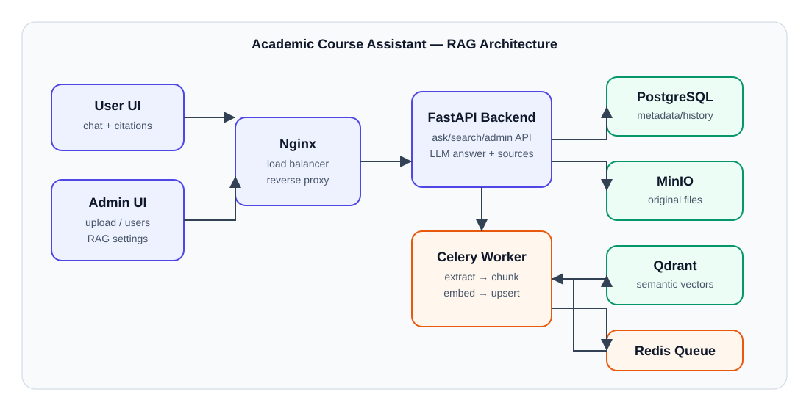

# Hệ thống Tìm kiếm Tài liệu Học thuật RAG

Một hệ thống Retrieval-Augmented Generation (RAG) sản phẩm cho phép tìm kiếm và trả lời các câu hỏi về tài liệu học thuật. Xây dựng với FastAPI, Next.js, PostgreSQL, và Qdrant.

## Trường hợp sử dụng

**Hỗ trợ Tài liệu Học thuật (Trường hợp 2 từ yêu cầu)**

Hệ thống này hỗ trợ sinh viên và giảng viên trả lời các câu hỏi về nội dung khóa học. Người dùng tải lên sách giáo khoa, ghi chú bài giảng, bộ bài tập và tài liệu cương. Hệ thống sau đó trả lời các truy vấn của sinh viên với câu trả lời dựa trên tài liệu này, kèm theo trích dẫn nguồn (tên tài liệu, số trang, điểm liên quan).

**Corpus mẫu:** giáo trình PDF, slide bài giảng, đề cương môn học, bài tập, ghi chú Markdown/TXT/DOCX.

**Câu hỏi demo:** “Decision Tree hoạt động như thế nào?”, “Loss function nào dùng cho logistic regression?”, “Tóm tắt nội dung sau Chapter 8”, “Nguồn nào nói về KNN?”.

**Tiêu chí thành công:** câu trả lời có căn cứ trong tài liệu, hiển thị ≥1 nguồn liên quan, Hit@5/MRR được đo trên 20–30 câu hỏi trong `docs/evaluation_template.csv`.

**Quy trình ví dụ:**
1. Giảng viên tải lên lịch trình khóa học và các tập PDF bài giảng qua bảng điều khiển quản trị
2. Hệ thống tự động trích xuất văn bản, chia nhỏ, nhúng và lập chỉ mục
3. Sinh viên hỏi: "Chủ đề chính của Chương 3 là gì?"
4. Hệ thống trả lời: Câu trả lời từ Chương 3 + trích dẫn nguồn
5. Sinh viên có thể đặt các câu hỏi tiếp theo và xem tất cả các nguồn được truy xuất

---

## 📋 Mục lục

- [Bắt đầu nhanh](#bắt-đầu-nhanh)
- [Trường hợp sử dụng](#trường-hợp-sử-dụng)
- [Kiến trúc](#kiến-trúc)
- [Các dịch vụ và cổng](#các-dịch-vụ-và-cổng)
- [Cách sử dụng](#cách-sử-dụng)
- [Stack công nghệ](#stack-công-nghệ)
- [Biến môi trường](#biến-môi-trường)
- [Phát triển](#phát-triển)
- [Các yêu cầu đã đáp ứng](#các-yêu-cầu-đã-đáp-ứng)
- [Nhóm](#nhóm)

---

## Bắt đầu nhanh

### Yêu cầu tiên quyết
- Docker Desktop (được cài đặt và chạy)
- 4 GB RAM được cấp cho Docker
- Khóa API Claude của bạn

### 1. Clone & Thiết lập

```bash
git clone <repo-url>
cd rag-system
cp .env.example .env
```

### 2. Thêm khóa API vào `.env`

```bash
ANTHROPIC_API_KEY=your-key-here
```

### 3. Khởi động mọi thứ

```bash
docker compose up -d --build
```

Chờ 5-10 phút lần đầu tiên (xây dựng ứng dụng Next.js, kéo hình ảnh, khởi tạo cơ sở dữ liệu).

### 4. Xác minh tất cả các dịch vụ đang chạy

```bash
docker compose ps
```

Tất cả 8 container phải hiển thị `running` hoặc `healthy`.

### 5. Mở giao diện người dùng

- **Chat người dùng:** http://localhost (hoặc http://localhost:3000)
- **Bảng điều khiển quản trị:** http://localhost/admin (hoặc http://localhost:3001)
- **Tài liệu API:** http://localhost/docs (hoặc http://localhost:8000/docs)
- **Bảng điều khiển MinIO:** http://localhost:9001 (đăng nhập: `minioadmin` / `minioadmin`)
- **Bảng điều khiển Qdrant:** http://localhost:6333/dashboard

---

## Cấu trúc thư mục

```
rag-system/
│
├── docker-compose.yml              # Điều phối tất cả 8 dịch vụ
├── .env                            # Cấu hình (khóa API, thông tin đăng nhập DB) — KHÔNG COMMIT
├── .env.example                    # Mẫu an toàn cho .env
├── .gitignore                      # Bảo vệ .env và bí mật
├── README.md                       # Tệp này
│
├── Dockerfile.backend              # Python 3.11 + FastAPI
├── Dockerfile.worker               # Python 3.11 + Celery
│
├── requirements.txt                # Phụ thuộc Python
│
├── backend/                        # FastAPI + logic RAG
│   ├── __init__.py
│   ├── config.py                   # Cài đặt từ .env
│   ├── main.py                     # Routes: /api/ask, /api/search, /api/documents
│   ├── rag_embedding.py            # Nhúng cục bộ sentence-transformers
│   ├── rag_chunking.py             # Chia nhỏ văn bản với lồng
│   ├── rag_extraction.py           # Trích xuất văn bản từ PDF/DOCX/TXT/MD
│   ├── bm25_search.py              # Tìm kiếm từ khóa BM25
│   ├── hybrid_search.py            # Tìm kiếm yêu cầu + kết hợp + xếp hạng lại
│   ├── models/
│   │   └── __init__.py             # Mô hình SQLAlchemy ORM
│   └── storage/
│       ├── __init__.py
│       ├── database.py             # Quản lý phiên PostgreSQL
│       ├── qdrant_client.py        # Các hoạt động cơ sở dữ liệu vector
│       └── minio_client.py         # Hoạt động lưu trữ đối tượng
│
├── worker/                         # Bộ xử lý nhiệm vụ nền Celery
│   ├── __init__.py
│   └── tasks/
│       ├── __init__.py
│       └── ingest.py               # Pipeline ingest tài liệu
│
├── frontend-user/                  # Giao diện chat người dùng (Next.js)
│   ├── Dockerfile
│   ├── .dockerignore
│   ├── package.json
│   ├── next.config.js
│   ├── tsconfig.json
│   ├── tailwind.config.js
│   ├── postcss.config.js
│   └── src/
│       └── app/
│           ├── globals.css        
│           ├── layout.tsx         
│           └── page.tsx           # Giao diện chat
│
├── frontend-admin/                 # Quản lý tài liệu (Next.js)
│   ├── Dockerfile
│   ├── .dockerignore
│   ├── package.json
│   ├── next.config.js
│   ├── tsconfig.json
│   ├── tailwind.config.js
│   ├── postcss.config.js
│   └── src/
│       └── app/
│           ├── globals.css        
│           ├── layout.tsx         
│           └── page.tsx           # Giao diện quản trị
│
└── nginx/                          # Reverse proxy / cân bằng tải
    ├── Dockerfile
    ├── nginx.conf                  # Cấu hình chính Nginx
    └── conf.d/
        └── default.conf            # Quy tắc định tuyến
```

---

## Kiến trúc



| Thành phần yêu cầu | Hiện thực trong dự án |
|---|---|
| Frontend người dùng | `frontend-user` — chat streaming, nguồn trích dẫn, lịch sử chat cục bộ |
| Frontend quản trị | `frontend-admin` — upload kéo/thả, quản lý tài liệu, user role/active, RAG settings |
| Backend | `backend` — FastAPI, auth, RAG answer/search/admin API |
| Database | PostgreSQL — user, document metadata, conversation history, system config |
| Object storage | MinIO — lưu file gốc/snapshot tài liệu |
| Vector database | Qdrant — dense semantic embeddings |
| Message queue | Redis + Celery — ingest/reindex nền |
| Load balancer | Nginx — route `/`, `/admin`, `/api`, `/docs` |

---

## Các dịch vụ và cổng

| Dịch vụ | Cổng | Mục đích |
|---------|------|---------|
| **Nginx** | 80 | Reverse proxy (điểm vào chính) |
| **Frontend Người dùng** | 3000 | Giao diện chat (Hỏi & Đáp) |
| **Frontend Quản trị** | 3001 | Bảng điều khiển quản trị |
| **Backend API** | 8000 | FastAPI + logic RAG |
| **PostgreSQL** | 5432 | Siêu dữ liệu tài liệu, lịch sử Q&A |
| **Qdrant** | 6333 | Cơ sở dữ liệu vector (nhúng) |
| **MinIO** | 9000 | Lưu trữ đối tượng (tệp được tải lên) |
| **Redis** | 6379 | Hàng đợi tin nhắn + bộ nhớ đệm |

---

## Cách sử dụng

### Quản trị: Tải lên tài liệu

1. Mở http://localhost/admin
2. Kéo hoặc nhấp để tải lên tệp PDF/TXT/DOCX/MD (tối đa 50 MB)
3. Theo dõi trạng thái: **đang chờ xử lý** → **đang xử lý** → **hoàn thành**
4. Sau khi hoàn thành, các phần xuất hiện trong Qdrant và chỉ mục BM25
5. Xem chi tiết tệp: kích thước, số lượng phần, thời gian tải lên

Để xóa tài liệu:
- Nhấp vào nút **Xóa**
- Điều này xóa nó từ MinIO (lưu trữ), PostgreSQL (siêu dữ liệu) và Qdrant (vector)

### Người dùng: Đặt câu hỏi

1. Mở http://localhost (giao diện chính)
2. Nhập câu hỏi, ví dụ: "Chủ đề chính của những tài liệu này là gì?"
3. Nhấp **Hỏi**
4. Claude trả lời:
   - **Câu trả lời** — dựa trên các tài liệu được tải lên của bạn
   - **Nguồn** — tên tệp, số trang, điểm liên quan, bản xem trước văn bản
5. Xem **lịch sử Q&A** qua điểm cuối `/api/conversations`

### API: Truy cập lập trình

**Liệt kê tài liệu:**
```bash
curl http://localhost:8000/api/documents
```

**Tải lên tệp:**
```bash
curl -X POST http://localhost:8000/api/documents/upload \
  -F "file=@myfile.pdf"
```

**Đặt câu hỏi:**
```bash
curl -X POST http://localhost:8000/api/ask \
  -H "Content-Type: application/json" \
  -d '{"question": "Tài liệu nói gì về X?", "top_k": 5}'
```

**Tìm kiếm ngữ nghĩa:**
```bash
curl -X POST http://localhost:8000/api/search \
  -H "Content-Type: application/json" \
  -d '{"query": "ứng dụng học máy", "top_k": 10}'
```

Tài liệu API đầy đủ: http://localhost/docs

---

## Stack công nghệ

### Frontend
- **Framework:** Next.js 14 (React 18, TypeScript)
- **Kiểu dáng:** Tailwind CSS
- **Chat người dùng:** Đầu vào câu hỏi thời gian thực, hiển thị phản hồi truyền phát, trích dẫn nguồn
- **Quản trị:** Tải lên tệp, bảng tài liệu, dò thăm trạng thái ingest (mỗi 3 giây)

### Backend
- **Framework:** FastAPI (Python 3.11)
- **LLM:** Claude qua proxy TrollLLM
- **Pipeline RAG:**
  - Nhúng: sentence-transformers semantic embeddings (cục bộ, không dùng hash fallback mặc định)
  - Tìm kiếm mật độ: cơ sở dữ liệu vector Qdrant
  - Tìm kiếm thưa: BM25 (thư viện rank-bm25)
  - Xếp hạng lại: mã hóa chéo (sentence-transformers)
  - Kết hợp: kết hợp xếp hạng tương hỗ (RRF)
- **Xử lý văn bản:**
  - PDF: pdfplumber + OCR fallback (`pytesseract`) cho trang scan/ảnh
  - DOCX: python-docx
  - TXT/MD: I/O tệp tiêu chuẩn
  - Chia nhỏ: cửa sổ trượt với overlap, lọc chunk nhỏ, merge chunk ngắn liền kề, dedup tùy chọn

### Cơ sở hạ tầng
- **Cơ sở dữ liệu:**
  - PostgreSQL 15 — siêu dữ liệu tài liệu, lịch sử hội thoại
  - Qdrant — lưu trữ vector (nhúng)
  - Redis 7 — hàng đợi tin nhắn (Celery), bộ nhớ đệm
- **Lưu trữ:** MinIO — lưu trữ đối tượng tương thích S3 (tệp được tải lên)
- **Hàng đợi tác vụ:** Celery + Redis — xử lý tài liệu nền
- **Reverse Proxy:** Nginx 1.27 — định tuyến và nén
- **Điều phối:** Docker Compose

---

## Biến môi trường

Sao chép `.env.example` vào `.env` và điền:

```bash
# Claude API (proxy TrollLLM)
ANTHROPIC_API_KEY=sk-trollllm-your-key-here
ANTHROPIC_BASE_URL=https://chat.trollllm.xyz
CLAUDE_MODEL=claude-opus-4-6

# Thông tin đăng nhập cơ sở dữ liệu
POSTGRES_USER=raguser
POSTGRES_PASSWORD=ragpass
POSTGRES_DB=rag_db

# Thông tin đăng nhập MinIO (mặc định, an toàn cho dev cục bộ)
MINIO_ACCESS_KEY=minioadmin
MINIO_SECRET_KEY=minioadmin

# Docker Hub (để đẩy hình ảnh, tùy chọn)
DOCKER_USER=yourusername
```

**Không bao giờ commit `.env` lên Git** — nó được trong `.gitignore`. Chỉ `.env.example` được theo dõi.

---

## Phát triển

### Thử nghiệm cục bộ (không Docker)

Để chạy backend + worker cục bộ để lặp lại nhanh hơn:

```bash
# Terminal 1: Backend API
uvicorn backend.main:app --reload --port 8000

# Terminal 2: Worker
celery -A worker.tasks.celery_app worker --loglevel=info --pool=solo

# Terminal 3: MinIO, Qdrant, PostgreSQL (vẫn trong Docker)
docker compose up postgres qdrant minio redis
```

### Nhật ký

```bash
# Tất cả dịch vụ
docker compose logs -f

# Dịch vụ cụ thể
docker compose logs -f backend
docker compose logs -f worker
docker compose logs -f frontend-user
```

### Xây dựng lại sau khi thay đổi mã

Thay đổi mã backend/worker:
```bash
docker compose build backend worker
docker compose up -d
```

Thay đổi mã frontend:
```bash
docker compose build frontend-user frontend-admin
docker compose up -d
```

Tất cả cùng một lúc:
```bash
docker compose build
docker compose up -d
```

### Monitoring (Prometheus + Grafana)

```bash
docker compose --profile monitoring up -d
```

- Prometheus: `http://localhost:9090`
- Grafana: `http://localhost:3002` (`GRAFANA_ADMIN_USER` / `GRAFANA_ADMIN_PASSWORD`)

### Backup scheduler (tự động)

```bash
docker compose --profile backup up -d backup-scheduler
```

- Chu kỳ backup: `BACKUP_INTERVAL_SECONDS` (mặc định `86400` = 24h)
- Backup thủ công:

```bash
./scripts/backup_all.sh
```

### SSL (Let's Encrypt + domain)

1) Trỏ domain về máy chạy Nginx, set `DOMAIN` trong `.env`.

2) Chạy stack SSL:

```bash
docker compose -f docker-compose.yml -f docker-compose.ssl.yml up -d
```

`certbot-renewer` sẽ tự renew + reload Nginx (HUP) sau khi cert thay đổi.

3) Cấp cert lần đầu:

```bash
docker compose -f docker-compose.yml -f docker-compose.ssl.yml run --rm certbot \
  certonly --webroot -w /var/www/certbot -d $DOMAIN --email you@example.com --agree-tos --no-eff-email
```

4) Reload Nginx:

```bash
docker compose restart nginx
```

### Production profile (internal-only services)

Chạy production với chỉ Nginx publish port ra host:

```bash
docker compose \
  -f docker-compose.yml \
  -f docker-compose.prod.yml \
  -f docker-compose.ssl.yml \
  --profile monitoring \
  --profile backup \
  --profile ssl \
  up -d
```

- Các service nội bộ (DB, Redis, backend, frontend app containers) không publish port host.
- Set CORS allowlist trong `.env`:

```bash
CORS_ALLOWED_ORIGINS=https://your-domain.com,https://www.your-domain.com
```

---

## Các yêu cầu đã đáp ứng

### ✅ Phần 1: Phát triển ứng dụng

**Frontend Người dùng**
- ✅ Giao diện đặt câu hỏi
- ✅ Hiển thị câu trả lời đầy đủ
- ✅ Trích dẫn nguồn với tên tài liệu, số trang, điểm liên quan
- ✅ Chỉ báo trạng thái API thời gian thực
- ✅ Giao diện sạch, thân thiện

**Frontend Quản trị**
- ✅ Tải lên tài liệu (kéo & thả)
- ✅ Danh sách tài liệu với theo dõi trạng thái
- ✅ Chẩn đoán ingest: số trang, số chunk, chunk bị loại, thời gian xử lý, lỗi
- ✅ Chẩn đoán PDF: trang rỗng/ít text, trang dùng OCR
- ✅ Xóa tài liệu
- ✅ Tái index từng tài liệu hoặc toàn bộ kho tri thức
- ✅ Quản lý quyền người dùng (`admin` / `user`) và trạng thái active
- ✅ Cấu hình RAG: chunking, retrieval, reranker, embedding metadata
- ✅ Re-embedding policy: đổi chunk/embedding/OCR setting → bấm **Reindex all** để queue lại toàn bộ kho tri thức
- ✅ Hình dung trạng thái ingest
- ✅ Bảng điều khiển thống kê

**Backend API**
- ✅ FastAPI REST API
- ✅ Pipeline RAG đầy đủ:
  - Tạo nhúng (sentence-transformers)
  - Tìm kiếm ngữ nghĩa mật độ (Qdrant)
  - Tìm kiếm từ khóa thưa (BM25)
  - Kết hợp RRF
  - Xếp hạng lại mã hóa chéo
  - Tạo câu trả lời dựa trên Claude
- ✅ Các điểm cuối quản lý tài liệu
- ✅ Các điểm cuối Q&A với theo dõi nguồn

**Lưu trữ: 3 loại bắt buộc**
- ✅ **Cơ sở dữ liệu:** PostgreSQL
- ✅ **Lưu trữ đối tượng:** MinIO
- ✅ **Cơ sở dữ liệu vector:** Qdrant

**Hàng đợi tin nhắn & Tác vụ nền**
- ✅ Redis + Celery cho xử lý tài liệu không đồng bộ
- ✅ Pipeline ingest nền
- ✅ Trải nghiệm người dùng không bị chặn

**Cân bằng tải**
- ✅ Reverse proxy Nginx
- ✅ Quy tắc định tuyến cho tất cả các dịch vụ
- ✅ Tối ưu hóa hiệu suất

### ✅ Phần 2: Đóng gói Docker
- ✅ `docker-compose.yml` quản lý tất cả 8 dịch vụ
- ✅ Dockerfile riêng cho mỗi dịch vụ
- ✅ Xây dựng nhiều giai đoạn
- ✅ Kiểm tra sức khỏe cho các dịch vụ quan trọng
- ✅ Volume lâu bền cho cơ sở dữ liệu
- ✅ Cấu hình biến môi trường
- ✅ Khởi động một lệnh: `docker-compose up -d`

### ✅ Phần 3: GitHub & Tài liệu
- ✅ Kho lưu trữ GitHub riêng tư
- ✅ Tất cả thành viên nhóm là cộng tác viên
- ✅ Truy cập đọc giáo viên được cấu hình
- ✅ Toàn bộ mã nguồn được đẩy lên
- ✅ README toàn diện với:
  - ✅ Mô tả dự án và trường hợp sử dụng
  - ✅ Sơ đồ kiến trúc
  - ✅ Hướng dẫn thiết lập hoàn chỉnh
  - ✅ Mô tả dịch vụ
  - ✅ Tài liệu biến môi trường
  - ✅ Hướng dẫn khắc phục sự cố
- ✅ Mẫu `.env.example` (không có bí mật trong git)
- ✅ Tài liệu phụ thuộc (requirements.txt, package.json)
- ✅ Mẫu đánh giá RAG: `docs/evaluation.md`, `docs/evaluation_template.csv`

### Các tính năng bổ sung được triển khai
- ✅ **Pipeline RAG nâng cao:** BM25 + RRF + xếp hạng lại mã hóa chéo
- ✅ **Hiệu quả hệ thống:** Docker Compose, Celery, Redis caching
- ✅ **Đánh giá chất lượng:** template Hit@k, MRR, citation relevance

---

## Khắc phục sự cố

**"docker compose up -d" treo trên xây dựng Next.js**
- Lần đầu tiên tải xuống ~500 MB gói npm. Chờ 10 phút.

**Backend không thể kết nối đến PostgreSQL**
- Đảm bảo container `postgres` khỏe mạnh: `docker compose logs postgres`
- Kiểm tra `DATABASE_URL` sử dụng `postgres:5432` (không `localhost`)

**Worker không xử lý tài liệu**
- Kiểm tra Redis: `docker compose logs redis`
- Kiểm tra worker: `docker compose logs worker`
- Đảm bảo cấu hình Celery trùng khớp

**Tải lên không thành công với lỗi "MinIO"**
- Khởi động lại MinIO: `docker compose restart minio`
- Kiểm tra bảng điều khiển MinIO: http://localhost:9001

**Hết bộ nhớ trong truy vấn đầu tiên**
- Tăng bộ nhớ Docker: Settings → Resources → 4+ GB
- Hoặc vô hiệu hóa xếp hạng lại

**API trả về lỗi 502**
- Kiểm tra nhật ký backend: `docker compose logs backend`
- Xác minh tất cả các dịch vụ lưu trữ khỏe mạnh: `docker compose ps`

---

## Nhóm

| Tên | Vai trò |
|-----|---------|
| [Tên của bạn] | Backend + Pipeline RAG |
| [Thành viên 2] | Frontend Người dùng |
| [Thành viên 3] | Frontend Quản trị |
| [Thành viên 4] | DevOps + Triển khai |

---
