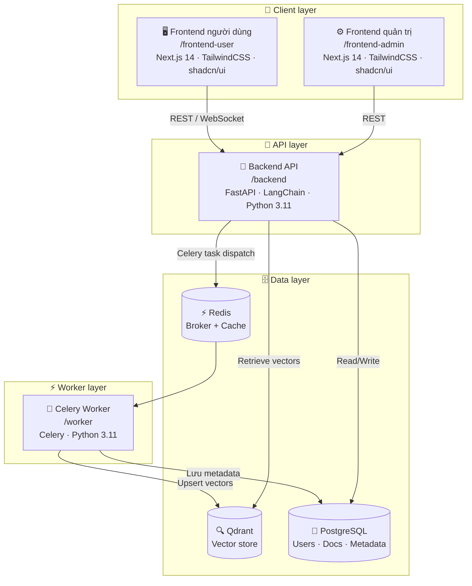

# 📚 RAG Knowledge Base System

> Hệ thống Retrieval-Augmented Generation (RAG) end-to-end — hỏi đáp thông minh dựa trên kho tài liệu nội bộ, tích hợp đầy đủ pipeline ingest → embed → query → answer với giao diện người dùng và quản trị viên.

---

## 📋 Mục lục

- [Tổng quan kiến trúc](#tổng-quan-kiến-trúc)
- [Thành phần hệ thống](#thành-phần-hệ-thống)
- [Cấu trúc thư mục](#cấu-trúc-thư-mục)
- [Tài khoản mặc định](#tài-khoản-mặc-định)
- [Luồng hoạt động](#luồng-hoạt-động)
- [Thành viên nhóm](#thành-viên-nhóm)

---

## Kiến trúc hệ thống



---

## Thành phần hệ thống

### 1. Frontend người dùng (`/frontend-user`)
- **Công nghệ:** Next.js 14, TailwindCSS, shadcn/ui
- **Chức năng:**
  - Giao diện chat hỏi đáp với AI
  - Hiển thị câu trả lời **streaming** theo thời gian thực
  - Hiển thị **nguồn trích dẫn** và đoạn văn liên quan (với tên tài liệu, trang, mức độ liên quan)
  - Lịch sử hội thoại
  - Đăng nhập / Đăng ký người dùng
  - Hỏi đáp trên **Quy trình** làm việc

### 2. Frontend quản trị (`/frontend-admin`)
- **Công nghệ:** Next.js 14, TailwindCSS, shadcn/ui
- **Chức năng:**
  - Quản lý người dùng: thêm, xóa, chỉnh sửa, phân quyền (admin / user)
  - Quản lý tài liệu: tải lên (PDF, DOCX, TXT, MD), xóa, tái index
  - Giám sát trạng thái ingest (pending → processing → completed / failed)
  - Cấu hình hệ thống: LLM model, chunk size, overlap, top-k retrieval
  - Thống kê sử dụng: số lượt truy vấn, tài liệu, người dùng

### 3. Backend API (`/backend`)
- **Công nghệ:** FastAPI, LangChain, Python 3.11
- **Chức năng:**
  - REST API + WebSocket (streaming)
  - Pipeline RAG: query → embed → retrieve → rerank → generate
  - Celery task dispatch

### 4. Celery Worker (`/worker`)
- **Công nghệ:** Celery, Python 3.11
- **Chức năng:**
  - Xử lý tác vụ nền: chunking → embedding → upsert vào Qdrant
  - Tái ingest khi tài liệu thay đổi
  - Retry logic cho các tác vụ thất bại

### 5. Lưu trữ

| Loại | Công nghệ | Mục đích |
|------|-----------|---------|
| SQL Database | PostgreSQL 15 | Users, documents metadata, conversations, permissions |
| Object Storage | MinIO | File gốc (PDF, DOCX, …), snapshot tài liệu |
| Vector Database | Qdrant | Embedding vectors cho RAG retrieval |
| Cache / Queue | Redis 7 | Session cache, Celery broker & result backend |

### 6. Load Balancer (`/nginx`)
- **Công nghệ:** Nginx 1.25
- **Chức năng:**
  - Reverse proxy tới frontend và backend
  - SSL termination (Let's Encrypt / self-signed)
  - Rate limiting
  - Gzip compression

---

## Cấu trúc thư mục

```
rag-system/
├── docker-compose.yml              # Orchestration toàn bộ hệ thống
├── docker-compose.override.yml     # Override cho môi trường dev
├── .env.example                    # Template biến môi trường
├── README.md
│
├── nginx/
│   ├── Dockerfile
│   ├── nginx.conf                  # Cấu hình chính
│   └── conf.d/
│       ├── user.conf               # Proxy tới frontend-user
│       ├── admin.conf              # Proxy tới frontend-admin
│       └── api.conf                # Proxy tới backend API
│
├── frontend-user/
│   ├── Dockerfile
│   ├── package.json
│   ├── next.config.js
│   └── src/
│       ├── app/
│       │   ├── (auth)/             # Login / Register pages
│       │   ├── chat/               # Chat interface
│       │   └── layout.tsx
│       ├── components/
│       │   ├── ChatWindow.tsx      # Streaming chat UI
│       │   ├── SourcePanel.tsx     # Hiển thị nguồn trích dẫn
│       │   └── MessageBubble.tsx
│       └── lib/
│           ├── api.ts
│           └── streaming.ts        # SSE / WebSocket handler
│
├── frontend-admin/
│   ├── Dockerfile
│   ├── package.json
│   └── src/
│       ├── app/
│       │   ├── dashboard/          # Tổng quan
│       │   ├── documents/          # Quản lý tài liệu
│       │   ├── users/              # Quản lý người dùng
│       │   └── settings/           # Cấu hình hệ thống
│       └── components/
│           ├── DocumentUploader.tsx
│           ├── IngestStatus.tsx    # Trạng thái ingest real-time
│           └── UserTable.tsx
│
├── backend/
│   ├── Dockerfile
│   ├── requirements.txt
│   ├── alembic/                    # Database migrations
│   │   ├── versions/
│   │   └── env.py
│   └── app/
│       ├── main.py                 # FastAPI entry point
│       ├── api/
│       │   ├── v1/
│       │   │   ├── auth.py         # Login, register, refresh token
│       │   │   ├── chat.py         # Query endpoint (streaming)
│       │   │   ├── documents.py    # Upload, delete, list, re-index
│       │   │   ├── users.py        # CRUD users (admin only)
│       │   │   └── settings.py     # System config
│       ├── core/
│       │   ├── config.py           # Settings từ .env
│       │   ├── security.py         # JWT, password hashing
│       │   └── deps.py             # Dependency injection
│       ├── models/
│       │   ├── user.py             # SQLAlchemy models
│       │   ├── document.py
│       │   └── conversation.py
│       ├── rag/
│       │   ├── embedder.py         # Text → vector embedding
│       │   ├── retriever.py        # Qdrant similarity search
│       │   ├── reranker.py         # Cross-encoder reranking
│       │   ├── generator.py        # LLM streaming generation
│       │   └── pipeline.py         # End-to-end RAG pipeline
│       ├── storage/
│       │   ├── minio_client.py     # MinIO operations
│       │   ├── qdrant_client.py    # Qdrant operations
│       │   └── postgres.py         # SQLAlchemy session
│       └── tasks/
│           └── ingest.py           # Celery task definitions
│
├── worker/
│   ├── Dockerfile
│   ├── requirements.txt
│   └── tasks/
│       ├── ingest_pipeline.py      # Chunking → embedding → upsert
│       ├── reindex.py              # Tái index tài liệu
│       └── cleanup.py             # Xóa vector khi xóa tài liệu
│
├── db/
│   └── init.sql                    # Khởi tạo schema PostgreSQL
│
└── scripts/
    ├── seed_admin.py               # Tạo tài khoản admin mặc định
    ├── healthcheck.sh              # Kiểm tra trạng thái services
    └── backup.sh                   # Backup DB + MinIO + Qdrant
```


### Lệnh quản lý thường dùng

```bash
# Xem log của một service
docker compose logs -f backend
docker compose logs -f worker

# Restart một service
docker compose restart backend

# Dừng toàn bộ hệ thống (giữ volume)
docker compose down

# Dừng và xóa toàn bộ dữ liệu (NGUY HIỂM)
docker compose down -v

# Scale worker (nếu cần xử lý nhiều tài liệu)
docker compose up -d --scale worker=3

# Chạy backup thủ công
docker compose exec backend bash /app/scripts/backup.sh
```

---

## Luồng hoạt động

### A. Luồng Ingest tài liệu (chạy nền)

```
Admin upload file
     │
     ▼
Backend nhận file
     │
     ├─► Lưu file gốc → MinIO (bucket: documents)
     ├─► Tạo record → PostgreSQL (status: pending)
     └─► Dispatch Celery task
              │
              ▼
         Celery Worker
              │
              ├─ 1. Parse file (PDF/DOCX/TXT → text)
              ├─ 2. Chunk text (size/overlap từ config)
              ├─ 3. Embed chunks (Embedding model)
              ├─ 4. Upsert vectors → Qdrant
              ├─ 5. Cập nhật status → PostgreSQL (completed)
              └─ 6. (Nếu lỗi) Retry & cập nhật status: failed
```

### B. Luồng RAG Query (streaming)

```
User gửi câu hỏi
     │
     ▼
Backend nhận query
     │
     ├─ 1. Embed query → vector
     ├─ 2. Similarity search → Qdrant (top-k chunks)
     ├─ 3. Rerank kết quả (cross-encoder)
     ├─ 4. Build prompt (system + context + query)
     ├─ 5. Stream LLM response → SSE
     └─ 6. Lưu conversation → PostgreSQL
              │
              ▼
         Frontend nhận stream
              │
              ├─ Hiển thị token dần dần
              └─ Hiển thị nguồn trích dẫn (sau khi stream xong)
```

---

## Thành viên nhóm

| STT | Họ và tên | MSSV | Nhiệm vụ |
|-----|-----------|------|---------|
| 1 | Nguyễn Minh Huy | 24022356 | |
| 2 | Cao Huy Hòa | 2021XXXXXX | |
| 3 | Phạm Vũ Nam | 2021XXXXXX | |
| 4 | Đinh Quang Minh | 2021XXXXXX |  |

> **Giảng viên hướng dẫn:** [Tên giảng viên] — Đã được thêm quyền đọc vào repository.

---

## Giấy phép

MIT License — Xem file [LICENSE](./LICENSE) để biết thêm chi tiết.
