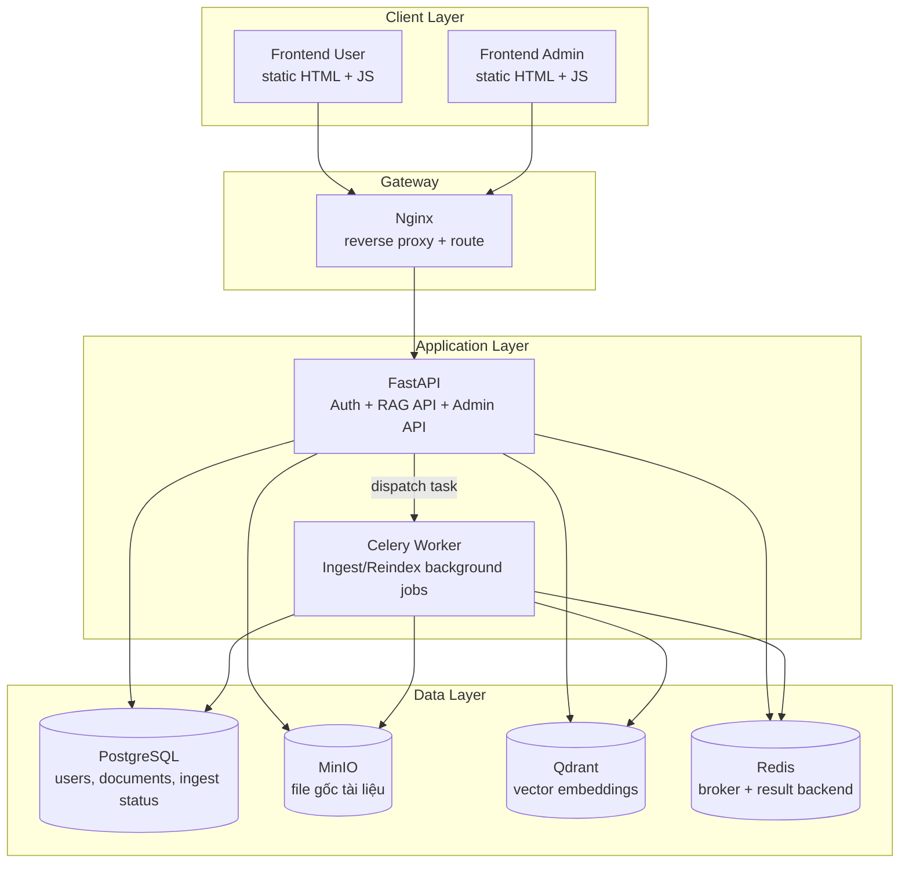

# 📚 RAG Knowledge Base System

> Hệ thống hỏi–đáp dựa trên tài liệu nội bộ với pipeline RAG đầy đủ: ingest tài liệu → chunking → embedding → lưu vector → truy vấn ngữ nghĩa → sinh câu trả lời có trích dẫn nguồn. Ingest/reindex chạy nền bằng queue để không chặn trải nghiệm người dùng.

---

## 📋 Mục lục

- [Tổng quan kiến trúc](#tổng-quan-kiến-trúc)
- [Thành phần hệ thống](#thành-phần-hệ-thống)
- [Luồng hoạt động](#luồng-hoạt-động)
- [Công nghệ sử dụng](#công-nghệ-sử-dụng)
- [Cấu trúc thư mục](#cấu-trúc-thư-mục)
- [Hướng dẫn chạy nhanh](#hướng-dẫn-chạy-nhanh)
- [Tài khoản mặc định](#tài-khoản-mặc-định)
- [API hiện có](#api-hiện-có)
- [Lệnh vận hành thường dùng](#lệnh-vận-hành-thường-dùng)
- [Quy trình tái hiện](#quy-trình-tái-hiện)
- [Quy trình đánh giá](#quy-trình-đánh-giá)
- [Tiêu chí đạt yêu cầu](#tiêu-chí-đạt-yêu-cầu)
- [Lưu ý bảo mật](#lưu-ý-bảo-mật)

---

## Tổng quan kiến trúc



---

## Thành phần hệ thống

### 1. Frontend người dùng (`frontend-user/`)

Giao diện hỏi–đáp dành cho người dùng cuối.

| Chức năng | Mô tả |
|---|---|
| Đăng nhập | Gọi API `/auth/login` lấy JWT |
| Hỏi đáp thường | Gọi API `/ask` |
| Hỏi đáp streaming | Gọi API SSE `/ask/stream` |
| Trích dẫn nguồn | Hiển thị source/page/score/snippet |

### 2. Frontend quản trị (`frontend-admin/`)

Giao diện vận hành kho tri thức và người dùng.

| Chức năng | Mô tả |
|---|---|
| Upload tài liệu | `/documents/upload` |
| Ingest web URL | `/documents/web` |
| Ingest text trực tiếp | `/documents/text` |
| Quản lý tài liệu | list/reindex/delete/task status |
| Quản lý user | create/list/delete user |
| Cấu hình hệ thống | chỉnh `chunk_size`, `chunk_overlap`, `top_k`, `llm_model` |
| Queue reindex all | `/ingest` |

### 3. Backend API (`api.py`)

FastAPI xử lý nghiệp vụ chính.

| Chức năng | Mô tả |
|---|---|
| JWT authentication | login + verify token |
| RBAC cơ bản | phân quyền `admin`/`user` |
| Document management | upload/web/text/reindex/delete |
| RAG query | retrieve + generate + citations |
| Streaming answer | SSE token streaming |
| Health check | trạng thái Postgres/MinIO/Qdrant/Redis |

### 4. Worker xử lý nền (`tasks.py`)

Celery worker xử lý ingest/reindex bất đồng bộ.

| Bước | Mô tả |
|---|---|
| 1 | Đọc metadata document từ PostgreSQL |
| 2 | Lấy file từ MinIO hoặc fetch web |
| 3 | Parse nội dung (PDF/TXT/MD/HTML hoặc web text) |
| 4 | Chunking + embedding + upsert vào Qdrant |
| 5 | Cập nhật trạng thái ingest trong PostgreSQL |

### 5. Lớp lưu trữ

| Thành phần | Vai trò |
|---|---|
| PostgreSQL | Lưu user + metadata tài liệu + ingest status |
| MinIO | Lưu file gốc tài liệu |
| Qdrant | Lưu vector embedding của chunks |
| Redis | Message queue và result backend cho Celery |

---

## Luồng hoạt động

### A. Luồng ingest tài liệu (background)

```text
Admin upload/ingest source
    -> API tạo record documents (status=pending)
    -> API dispatch Celery task
    -> Worker xử lý parse/chunk/embed/upsert
    -> Worker cập nhật status=completed/failed
```

### B. Luồng hỏi đáp RAG

```text
User gửi câu hỏi
    -> API embed query
    -> Qdrant semantic search top-k
    -> API build prompt từ chunks retrieve được
    -> LLM sinh câu trả lời
    -> Trả về answer + citations
```

### C. Luồng streaming

```text
User gọi /ask/stream
    -> API gửi event citations
    -> API stream token dần qua SSE
    -> API gửi event done khi kết thúc
```

---

## Công nghệ sử dụng

- Backend: FastAPI, SQLAlchemy, Uvicorn
- RAG: LangChain, langchain-qdrant, Google Generative AI embeddings + LLM
- Vector DB: Qdrant
- Object Storage: MinIO
- Database: PostgreSQL
- Queue: Celery + Redis
- Gateway: Nginx
- Containerization: Docker, Docker Compose

---

## Cấu trúc thư mục

```text
.
├── api.py
├── auth.py
├── celery_app.py
├── db.py
├── rag.py
├── rag_ingest.py
├── tasks.py
├── storage.py
├── requirement.txt
├── Dockerfile
├── docker-compose.yml
├── nginx/
│   └── nginx.conf
├── frontend-user/
│   ├── Dockerfile
│   └── index.html
├── frontend-admin/
│   ├── Dockerfile
│   └── index.html
├── rag-system/
│   └── db/
│       └── init.sql
```

---

## Hướng dẫn chạy nhanh

### 1. Chuẩn bị

- Cài Docker Desktop (hoặc Docker Engine + Compose).
- Tạo file cấu hình từ template:

```bash
cp .env.example .env
```

- Cập nhật bắt buộc trong `.env`:
  - `GOOGLE_API_KEY`
  - `SECRET_KEY` (>= 32 ký tự)
  - `ADMIN_PASSWORD` (không dùng giá trị mặc định)
- Ghi chú: file upload được lưu tạm tại `RAG_STAGING_DIR` (mặc định `/tmp/rag-staging`), không cần bind thư mục `data/` của project.

### 2. Build và chạy

```bash
docker compose up -d --build
```

### 3. Kiểm tra service

```bash
docker compose ps
curl http://localhost/api/health
```

### 4. Truy cập giao diện

- User UI: `http://localhost/`
- Admin UI: `http://localhost/admin/`
- API docs: `http://localhost/api/docs`

### 5. Truy cập dịch vụ data (nếu cần)

- MinIO Console: `http://localhost:9001`
- Qdrant API: `http://localhost:6333`
- PostgreSQL: `localhost:5432`
- Redis: `localhost:6379`

---

## Tài khoản mặc định

- Admin email: `admin@example.com`
- Admin password: `admin123`

Tài khoản này được seed tự động khi backend startup (`seed_default_admin`).

---

## API hiện có

### Public

- `GET /health`
- `POST /auth/login`

### Authenticated user/admin

- `GET /me`
- `POST /ask`
- `POST /ask/stream`

### Admin only

- `GET /users`
- `POST /users`
- `PATCH /users/{user_id}`
- `DELETE /users/{user_id}`
- `GET /settings`
- `PATCH /settings`
- `POST /upload` (alias cũ)
- `POST /documents/upload`
- `POST /documents/web`
- `POST /documents/text`
- `GET /documents`
- `GET /documents/{doc_id}`
- `GET /documents/{doc_id}/task`
- `POST /documents/{doc_id}/reindex`
- `DELETE /documents/{doc_id}`
- `POST /ingest`

---

## Lệnh vận hành thường dùng

```bash
# Theo dõi log
docker compose logs -f api
docker compose logs -f worker
docker compose logs -f nginx

# Restart service
docker compose restart api worker

# Dừng toàn bộ
docker compose down

# Dừng và xóa toàn bộ dữ liệu volume
docker compose down -v

# Scale worker khi ingest lớn
docker compose up -d --scale worker=3

# Backup dữ liệu nhanh (Postgres + MinIO + Qdrant)
bash scripts/backup.sh
```

---

## Quy trình tái hiện

### Mục tiêu

Tái hiện đầy đủ hệ thống RAG đa dịch vụ bằng Docker Compose và xác nhận pipeline hoạt động từ ingest đến hỏi–đáp có trích dẫn.

### Điều kiện môi trường

- Docker + Docker Compose.
- Cổng trống: `80, 5432, 6379, 6333, 9000, 9001`.
- `.env` hợp lệ được tạo từ `.env.example`.

### Các bước thực hiện

1. Khởi động hệ thống:

```bash
docker compose up -d --build
```

2. Kiểm tra service:

```bash
docker compose ps
curl http://localhost/api/health
```

3. Đăng nhập Admin tại `http://localhost/admin/` với:
- `admin@example.com`
- `admin123`

4. Ingest ít nhất 1 tài liệu bằng một trong ba cách:
- Upload file (`/documents/upload`)
- Ingest URL (`/documents/web`)
- Ingest text (`/documents/text`)

5. Theo dõi trạng thái ingest:
- Vào bảng Documents trên admin UI.
- Trạng thái phải đi qua `pending/processing` và về `completed`.

6. Truy vấn từ user UI `http://localhost/`:
- Đăng nhập.
- Hỏi câu liên quan nội dung vừa ingest.
- Xác nhận có `answer` và danh sách `citations`.

---

## Quy trình đánh giá

### Kịch bản demo tối thiểu (5–10 phút)

1. Mở `http://localhost/api/health` để chứng minh dependency sống.
2. Admin ingest một tài liệu mới.
3. Kiểm tra task ingest và trạng thái completed.
4. User đặt câu hỏi lấy thông tin từ tài liệu.
5. Trình bày trích dẫn nguồn (source/page/snippet).
6. Thực hiện reindex một tài liệu.
7. Thực hiện delete tài liệu và refresh danh sách.

### Bằng chứng nên chụp cho báo cáo

- `docker compose ps` đầy đủ container.
- API health response.
- Màn hình admin: ingest + trạng thái.
- Màn hình user: answer + citations.
- Log worker khi ingest (`docker compose logs -f worker`).

---

## Tiêu chí đạt yêu cầu

### Checklist theo yêu cầu nhánh RAG

- [x] Ingest tài liệu (file/web/text).
- [x] Chunking + embedding + lưu vector database.
- [x] Semantic query + sinh câu trả lời.
- [x] Trả lời có trích dẫn nguồn.
- [x] Queue nền cho ingest/reindex (Celery + Redis).
- [x] Frontend user cho hỏi đáp.
- [x] Frontend admin cho quản lý user/document/ingest.
- [x] Backend API điều phối nghiệp vụ.
- [x] Sử dụng đủ 3 lớp lưu trữ:
  - SQL: PostgreSQL
  - Object storage: MinIO
  - Vector DB: Qdrant
- [x] Có load balancer/reverse proxy: Nginx.

### Trạng thái hiện tại

Hệ thống đáp ứng đầy đủ yêu cầu cốt lõi của bài toán RAG containerized.  
Các hạng mục cộng điểm (CI/CD, Kubernetes/Helm, monitoring, backup pipeline, multi-layer cache, internet deployment với SSL/domain) chưa được triển khai trong repository hiện tại.

---

## Lưu ý bảo mật

- Không commit `.env` thật (chứa API key).
- Bắt buộc đổi `SECRET_KEY` và `ADMIN_PASSWORD` mặc định trước khi deploy internet.
- Hạn chế `allow_origins` trong CORS cho production.
- Khuyến nghị bật HTTPS (nginx + TLS) nếu public ra ngoài.
- Khi chạy `APP_ENV=production`, backend sẽ từ chối khởi động nếu phát hiện cấu hình bảo mật mặc định.

---

## Use cases phù hợp

Hệ thống hiện tại dùng được cho cả hai tình huống:

- Trường hợp 1: Trợ lý nội bộ doanh nghiệp (quy trình, handbook, wiki).
- Trường hợp 2: Trợ lý tra cứu học thuật/môn học (giáo trình, đề cương, bài tập).

Phân loại 1 hay 2 phụ thuộc vào bộ tài liệu bạn ingest vào kho tri thức.
