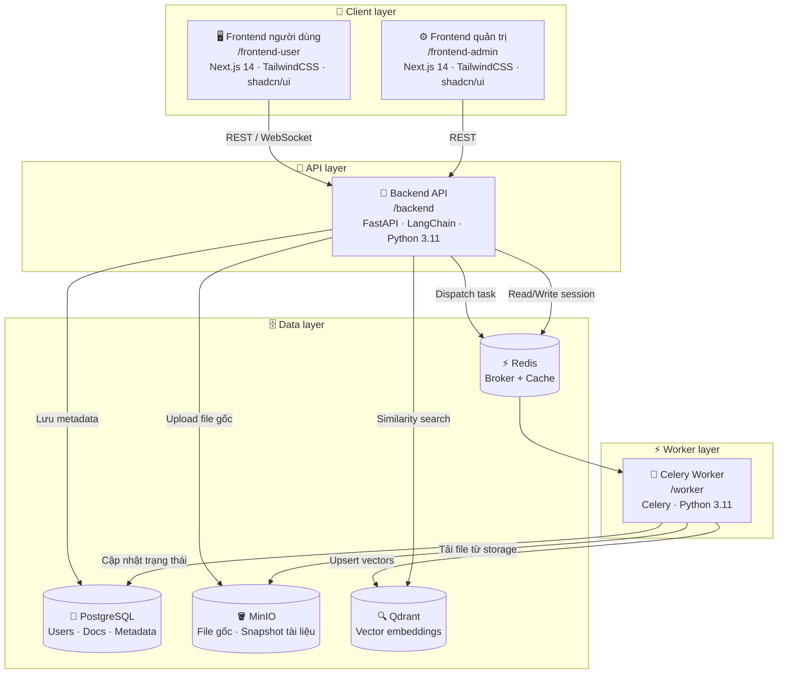
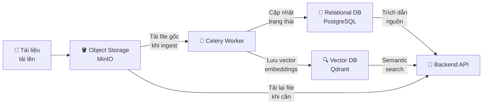

# 📚 RAG Knowledge Base System

> Hệ thống Retrieval-Augmented Generation (RAG) end-to-end — hỏi đáp thông minh dựa trên kho tài liệu nội bộ, tích hợp đầy đủ pipeline ingest → embed → query → answer với giao diện người dùng và quản trị viên.

---

## 📋 Mục lục

- [Tổng quan kiến trúc](#tổng-quan-kiến-trúc)
- [Thành phần hệ thống](#thành-phần-hệ-thống)
- [Cấu trúc thư mục](#cấu-trúc-thư-mục)
- [Tài khoản mặc định](#tài-khoản-mặc-định)
- [Luồng hoạt động](#luồng-hoạt-động)
- [Thành viên nhóm](#thành-viên-nhóm)

---

## Kiến trúc hệ thống



---

## Thành phần

### 1. Frontend người dùng (`/frontend-user`)

Giao diện dành cho nhân viên hỏi đáp với trợ lý AI.

| Chức năng | Mô tả |
|---|---|
| 💬 Chat hỏi đáp | Giao diện nhắn tin với AI, hỗ trợ markdown |
| ⚡ Streaming | Câu trả lời hiển thị theo thời gian thực qua WebSocket |
| 📄 Trích dẫn nguồn | Hiển thị tên tài liệu, số trang, điểm liên quan cho mỗi đoạn |
| 📜 Lịch sử hội thoại | Lưu và xem lại các cuộc trò chuyện trước |
| 🔐 Xác thực | Đăng nhập / Đăng ký tài khoản |
| 📋 Hỏi đáp quy trình | Đặt câu hỏi theo từng quy trình / wiki nội bộ cụ thể |

---

### 2. Frontend quản trị (`/frontend-admin`)

Giao diện dành cho người quản lý kho tri thức doanh nghiệp.

| Chức năng | Mô tả |
|---|---|
| 👤 Quản lý người dùng | Thêm, xóa, chỉnh sửa, phân quyền `admin / user` |
| 📂 Quản lý tài liệu | Tải lên PDF, DOCX, TXT, MD · Xóa · Tái index |
| 📊 Giám sát ingest | Theo dõi trạng thái: `pending → processing → completed / failed` |
| ⚙️ Cấu hình RAG | Điều chỉnh LLM model, chunk size, overlap, top-k retrieval |
| 📈 Thống kê | Số lượt truy vấn, tài liệu hoạt động, người dùng |

---

### 3. Backend API (`/backend`)

Lõi xử lý RAG và điều phối toàn bộ hệ thống.

| Chức năng | Mô tả |
|---|---|
| 🔄 Pipeline RAG | `query → embed → retrieve → rerank → generate` |
| 📡 Streaming | Đẩy câu trả lời về client qua WebSocket |
| 🔐 Xác thực | JWT authentication |
| 🛡️ Phân quyền | RBAC (Role-Based Access Control) |
| 📬 Task dispatch | Gửi tác vụ ingest sang Celery qua Redis |

---

### 4. Celery Worker (`/worker`)

Xử lý bất đồng bộ việc đưa tài liệu vào kho tri thức.

| Chức năng | Mô tả |
|---|---|
| 📥 Ingest tài liệu | `chunking → embedding → upsert vào Qdrant` |
| 🔁 Tái ingest | Tự động cập nhật khi tài liệu thay đổi |
| 🔃 Retry logic | Tự động thử lại khi tác vụ thất bại |

---

## Chiến lược lưu trữ

Hệ thống sử dụng **ba loại lưu trữ chuyên biệt**, mỗi loại phục vụ một mục đích riêng biệt trong pipeline:



### 1. 🐘 Relational Database — PostgreSQL

Lưu trữ toàn bộ **dữ liệu có cấu trúc** của hệ thống.

| Bảng | Dữ liệu lưu trữ |
|---|---|
| `users` | Tài khoản, mật khẩu hash, role (`admin / user`), thời gian tạo |
| `documents` | Tên file, loại, đường dẫn MinIO, trạng thái ingest, phiên bản |
| `document_chunks` | Mapping chunk ↔ document (chunk_id, vị trí, trang) |
| `conversations` | Lịch sử hội thoại, user_id, timestamp |
| `messages` | Nội dung tin nhắn, role (`user / assistant`), citation refs |
| `ingest_logs` | Lịch sử các lần ingest, trạng thái, lỗi nếu có |
| `system_config` | Cấu hình RAG: chunk size, overlap, top-k, LLM model |

### 2. 🪣 Object Storage — MinIO (tương thích S3)

Lưu trữ **file nhị phân gốc** — tách biệt hoàn toàn khỏi database để tối ưu hiệu năng và chi phí.

| Bucket | Nội dung |
|---|---|
| `documents-raw` | File gốc khi người dùng tải lên (PDF, DOCX, TXT, MD) |
| `documents-processed` | File đã qua xử lý / chuẩn hoá (text đã extract) |
| `snapshots` | Snapshot tài liệu theo từng phiên bản (để rollback) |

> **Lý do dùng Object Storage riêng:** File tài liệu có thể rất lớn (hàng chục MB/file). Lưu blob trực tiếp vào SQL làm chậm query và tốn bộ nhớ. MinIO cho phép truy cập file theo pre-signed URL, hỗ trợ versioning, và dễ dàng scale theo dung lượng.

### 3. 🔍 Vector Database — Qdrant

Lưu trữ **vector embeddings** của từng chunk tài liệu để phục vụ tìm kiếm ngữ nghĩa (semantic search).

| Collection | Nội dung |
|---|---|
| `document_vectors` | Vector embedding của mỗi chunk · payload gồm `doc_id`, `chunk_index`, `page`, `text_preview` |

| Trường payload | Mô tả |
|---|---|
| `doc_id` | Liên kết về bản ghi trong PostgreSQL |
| `chunk_index` | Thứ tự chunk trong tài liệu gốc |
| `page` | Số trang (dùng để hiển thị trích dẫn) |
| `source_path` | Đường dẫn MinIO để tải lại file gốc nếu cần |
| `text_preview` | 200 ký tự đầu của chunk (hiển thị nhanh không cần query PG) |

---

---

## Cấu trúc thư mục

```
rag-system/
├── docker-compose.yml              # Orchestration toàn bộ hệ thống
├── docker-compose.override.yml     # Override cho môi trường dev
├── .env.example                    # Template biến môi trường
├── README.md
│
├── nginx/
│   ├── Dockerfile
│   ├── nginx.conf                  # Cấu hình chính
│   └── conf.d/
│       ├── user.conf               # Proxy tới frontend-user
│       ├── admin.conf              # Proxy tới frontend-admin
│       └── api.conf                # Proxy tới backend API
│
├── frontend-user/
│   ├── Dockerfile
│   ├── package.json
│   ├── next.config.js
│   └── src/
│       ├── app/
│       │   ├── (auth)/             # Login / Register pages
│       │   ├── chat/               # Chat interface
│       │   └── layout.tsx
│       ├── components/
│       │   ├── ChatWindow.tsx      # Streaming chat UI
│       │   ├── SourcePanel.tsx     # Hiển thị nguồn trích dẫn
│       │   └── MessageBubble.tsx
│       └── lib/
│           ├── api.ts
│           └── streaming.ts        # SSE / WebSocket handler
│
├── frontend-admin/
│   ├── Dockerfile
│   ├── package.json
│   └── src/
│       ├── app/
│       │   ├── dashboard/          # Tổng quan
│       │   ├── documents/          # Quản lý tài liệu
│       │   ├── users/              # Quản lý người dùng
│       │   └── settings/           # Cấu hình hệ thống
│       └── components/
│           ├── DocumentUploader.tsx
│           ├── IngestStatus.tsx    # Trạng thái ingest real-time
│           └── UserTable.tsx
│
├── backend/
│   ├── Dockerfile
│   ├── requirements.txt
│   ├── alembic/                    # Database migrations
│   │   ├── versions/
│   │   └── env.py
│   └── app/
│       ├── main.py                 # FastAPI entry point
│       ├── api/
│       │   ├── v1/
│       │   │   ├── auth.py         # Login, register, refresh token
│       │   │   ├── chat.py         # Query endpoint (streaming)
│       │   │   ├── documents.py    # Upload, delete, list, re-index
│       │   │   ├── users.py        # CRUD users (admin only)
│       │   │   └── settings.py     # System config
│       ├── core/
│       │   ├── config.py           # Settings từ .env
│       │   ├── security.py         # JWT, password hashing
│       │   └── deps.py             # Dependency injection
│       ├── models/
│       │   ├── user.py             # SQLAlchemy models
│       │   ├── document.py
│       │   └── conversation.py
│       ├── rag/
│       │   ├── embedder.py         # Text → vector embedding
│       │   ├── retriever.py        # Qdrant similarity search
│       │   ├── reranker.py         # Cross-encoder reranking
│       │   ├── generator.py        # LLM streaming generation
│       │   └── pipeline.py         # End-to-end RAG pipeline
│       ├── storage/
│       │   ├── minio_client.py     # MinIO operations
│       │   ├── qdrant_client.py    # Qdrant operations
│       │   └── postgres.py         # SQLAlchemy session
│       └── tasks/
│           └── ingest.py           # Celery task definitions
│
├── worker/
│   ├── Dockerfile
│   ├── requirements.txt
│   └── tasks/
│       ├── ingest_pipeline.py      # Chunking → embedding → upsert
│       ├── reindex.py              # Tái index tài liệu
│       └── cleanup.py             # Xóa vector khi xóa tài liệu
│
├── db/
│   └── init.sql                    # Khởi tạo schema PostgreSQL
│
└── scripts/
    ├── seed_admin.py               # Tạo tài khoản admin mặc định
    ├── healthcheck.sh              # Kiểm tra trạng thái services
    └── backup.sh                   # Backup DB + MinIO + Qdrant
```


### Lệnh quản lý thường dùng

```bash
# Xem log của một service
docker compose logs -f backend
docker compose logs -f worker

# Restart một service
docker compose restart backend

# Dừng toàn bộ hệ thống (giữ volume)
docker compose down

# Dừng và xóa toàn bộ dữ liệu (NGUY HIỂM)
docker compose down -v

# Scale worker (nếu cần xử lý nhiều tài liệu)
docker compose up -d --scale worker=3

# Chạy backup thủ công
docker compose exec backend bash /app/scripts/backup.sh
```

---

## Luồng hoạt động

### A. Luồng Ingest tài liệu (chạy nền)

```
Admin upload file
     │
     ▼
Backend nhận file
     │
     ├─► Lưu file gốc → MinIO (bucket: documents)
     ├─► Tạo record → PostgreSQL (status: pending)
     └─► Dispatch Celery task
              │
              ▼
         Celery Worker
              │
              ├─ 1. Parse file (PDF/DOCX/TXT → text)
              ├─ 2. Chunk text (size/overlap từ config)
              ├─ 3. Embed chunks (Embedding model)
              ├─ 4. Upsert vectors → Qdrant
              ├─ 5. Cập nhật status → PostgreSQL (completed)
              └─ 6. (Nếu lỗi) Retry & cập nhật status: failed
```

### B. Luồng RAG Query (streaming)

```
User gửi câu hỏi
     │
     ▼
Backend nhận query
     │
     ├─ 1. Embed query → vector
     ├─ 2. Similarity search → Qdrant (top-k chunks)
     ├─ 3. Rerank kết quả (cross-encoder)
     ├─ 4. Build prompt (system + context + query)
     ├─ 5. Stream LLM response → SSE
     └─ 6. Lưu conversation → PostgreSQL
              │
              ▼
         Frontend nhận stream
              │
              ├─ Hiển thị token dần dần
              └─ Hiển thị nguồn trích dẫn (sau khi stream xong)
```

---

## Thành viên nhóm

| STT | Họ và tên | MSSV | Nhiệm vụ |
|-----|-----------|------|---------|
| 1 | Nguyễn Minh Huy | 24022356 | |
| 2 | Cao Huy Hòa | 2021XXXXXX | |
| 3 | Phạm Vũ Nam | 2021XXXXXX | |
| 4 | Đinh Quang Minh | 2021XXXXXX |  |

> **Giảng viên hướng dẫn:** [Tên giảng viên] — Đã được thêm quyền đọc vào repository.

---

## Giấy phép

MIT License — Xem file [LICENSE](./LICENSE) để biết thêm chi tiết.
